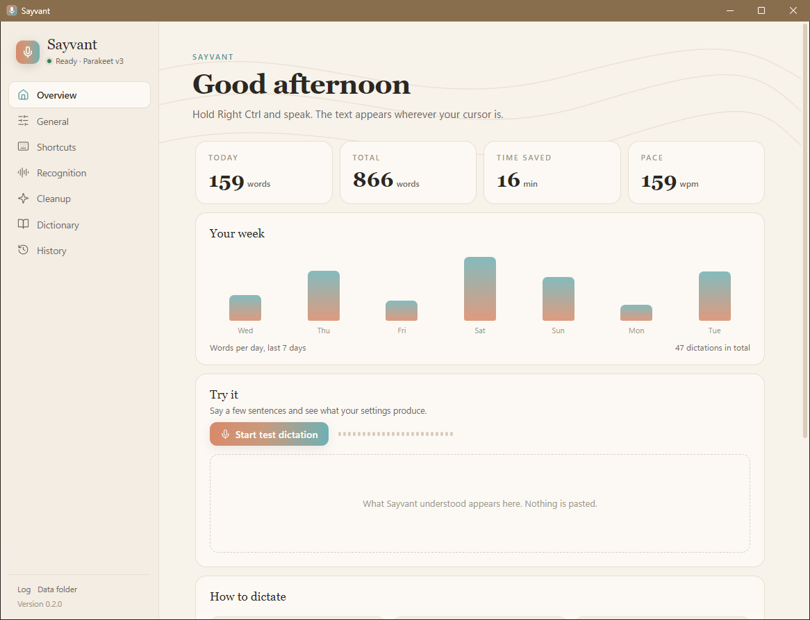
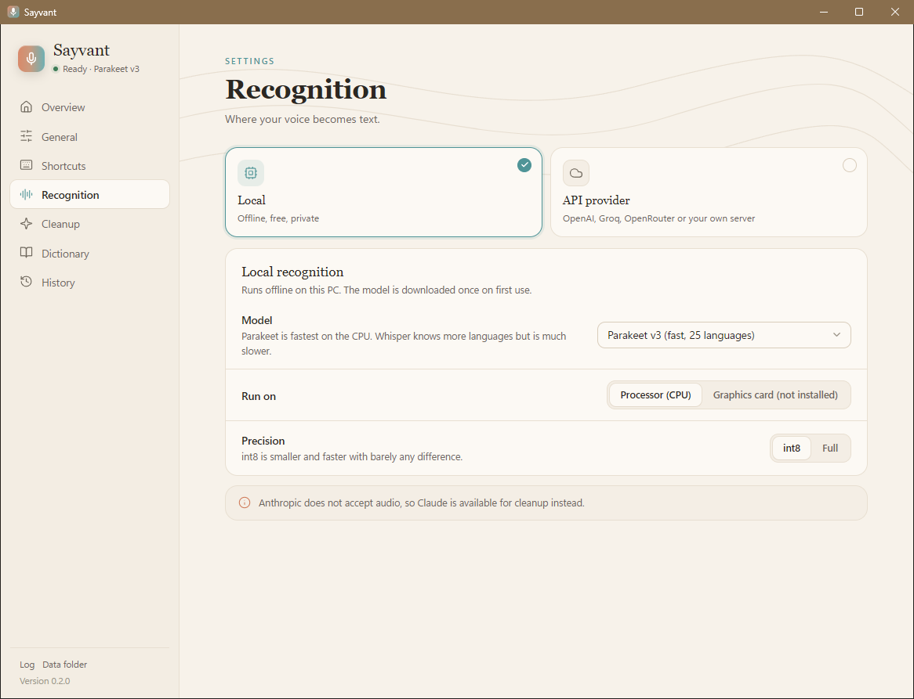
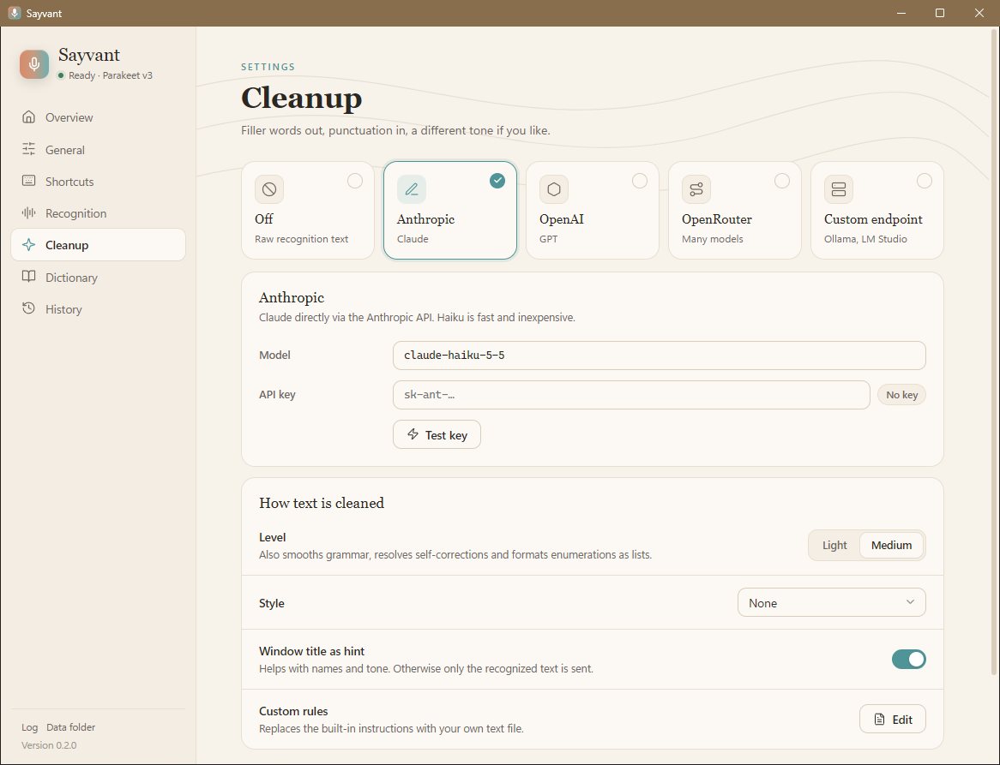
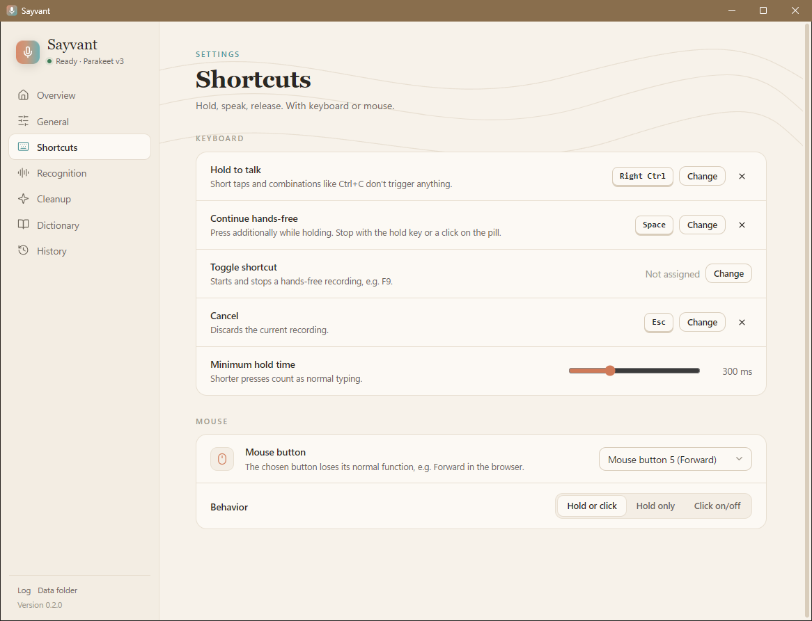
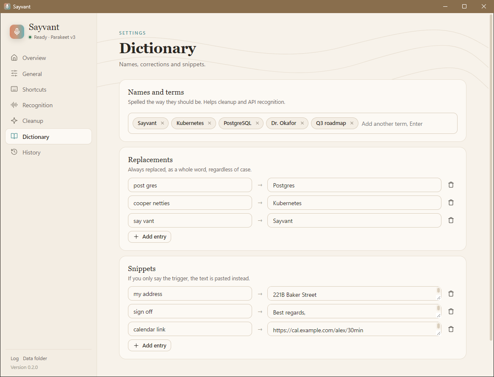
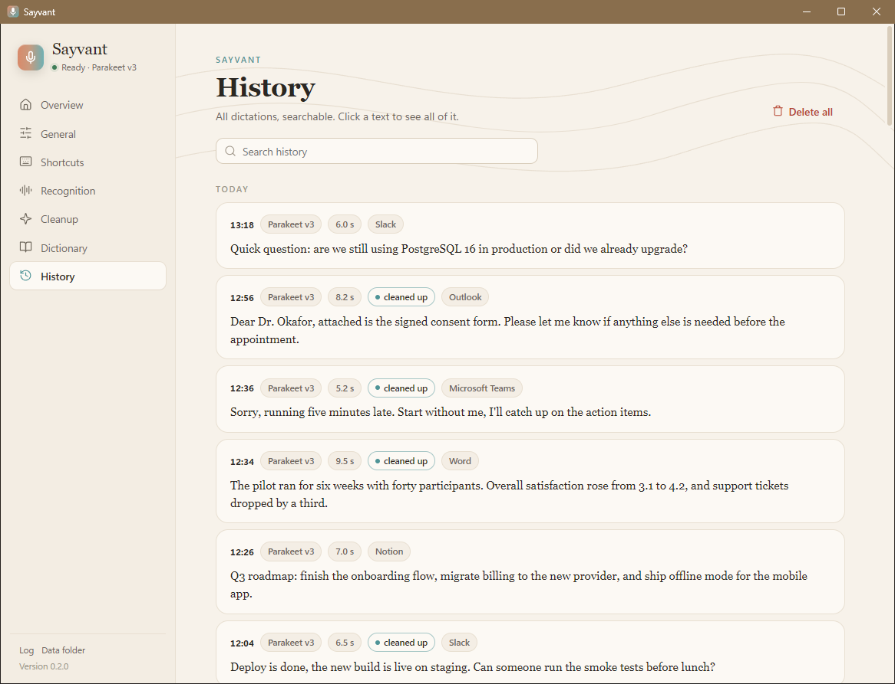
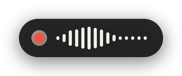
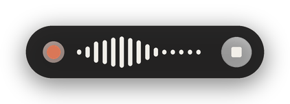
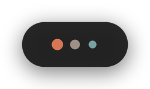
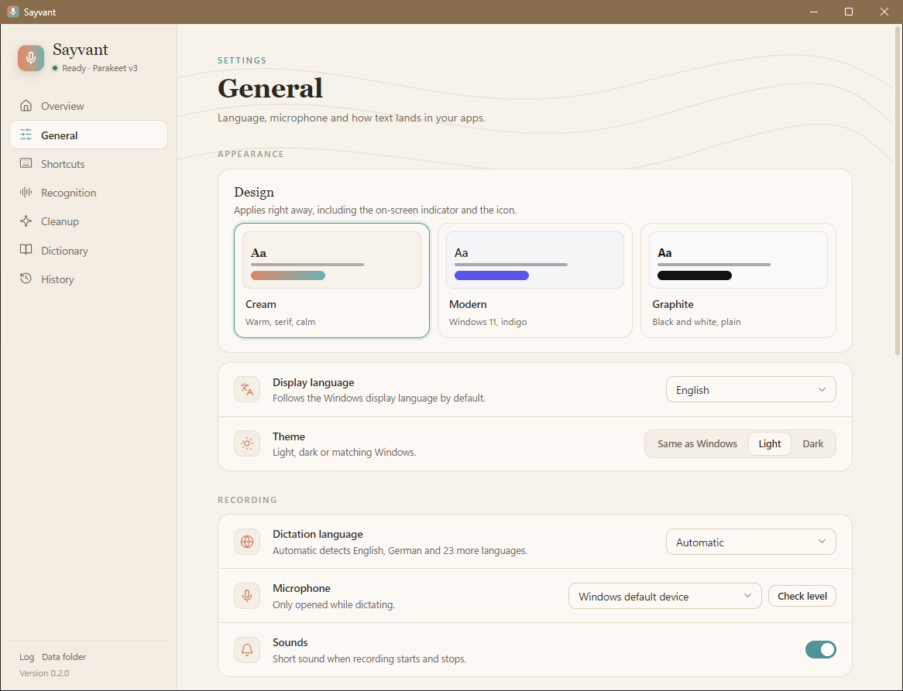

<div align="center">


# Sayvant

**Diktieren unter Windows per Tastendruck.** Taste halten, sprechen, loslassen, und der Text steht dort, wo der Cursor ist, in jedem Programm.
Die Erkennung läuft standardmäßig lokal auf deinem PC. Kein Konto, kein Abo, keine Telemetrie.

[Download](https://github.com/Githubtezla/Sayvant/releases) · [English](README.md) · [Code signing policy](CODE_SIGNING_POLICY.md)

  

</div>



Die Screenshots zeigen die englische Oberfläche. Sayvant gibt es auf Deutsch und Englisch, die Sprache richtet sich nach Windows und lässt sich umstellen.

## Inhalt

- [So funktioniert es](#so-funktioniert-es)
- [Funktionen](#funktionen)
- [Installation](#installation)
- [Erste Schritte](#erste-schritte)
- [Spracherkennung](#spracherkennung)
- [Nachbearbeitung mit einem Sprachmodell](#nachbearbeitung-mit-einem-sprachmodell)
- [Kurzbefehle](#kurzbefehle)
- [Wörterbuch und Textbausteine](#wörterbuch-und-textbausteine)
- [Übersicht und Verlauf](#übersicht-und-verlauf)
- [Die Aufnahmeanzeige](#die-aufnahmeanzeige)
- [Designs](#designs)
- [Weitere Einstellungen](#weitere-einstellungen)
- [Datenschutz](#datenschutz)
- [Tipps und Fehlerbehebung](#tipps-und-fehlerbehebung)
- [Deinstallieren](#deinstallieren)
- [Aus dem Quellcode bauen](#aus-dem-quellcode-bauen)
- [Danksagung und Lizenz](#danksagung-und-lizenz)

## So funktioniert es

1. Cursor in ein beliebiges Textfeld setzen: eine Mail, ein Chat, ein Dokument, ein Code-Editor, ein Formular im Browser.
2. **Rechte Strg-Taste** (oder Maustaste 5) halten und sprechen.
3. Loslassen. Sayvant schreibt auf, was du gesagt hast, und fügt es an der Cursorposition ein.

Mehr ist es nicht. Sayvant wartet im Infobereich und bleibt unsichtbar, bis du die Taste hältst. Eine kleine Anzeige unten am Bildschirm zeigt, dass zugehört wird und wie laut du bist.

## Funktionen

| Funktion | Was du bekommst |
|---|---|
| **Lokal und privat** | Parakeet v3 läuft auf der CPU, braucht nach dem ersten Download kein Internet, versteht 25 Sprachen und setzt selbst Satzzeichen. Canary und Whisper stehen als Alternativen bereit. |
| **Funktioniert überall** | Der Text landet an der Cursorposition, in jedem Windows-Programm. |
| **APIs, wenn du willst** | OpenAI, Groq, OpenRouter (Gemini, GPT-Audio, Voxtral) oder ein eigener Whisper-Server, mit automatischem Rückfall auf die lokale Erkennung. |
| **Nachbearbeitung auf Wunsch** | Ein Sprachmodell entfernt Füllwörter, korrigiert Zeichensetzung und Grammatik, löst Selbstkorrekturen auf und ändert auf Wunsch den Ton. Anthropic (Claude), OpenAI, OpenRouter oder ein lokales Modell über Ollama oder LM Studio. |
| **Tastatur und Maus** | Halten zum Sprechen, zusätzlich Leertaste für freihändig, Esc bricht ab, optional ein Umschalter, und eine Maustaste, die genauso funktioniert. |
| **Wörterbuch und Bausteine** | Namen und Fachbegriffe, Korrekturen für Wörter, die immer falsch erkannt werden, und längere Texte per kurzem Auslöser. |
| **Übersicht und Verlauf** | Wörter pro Tag, gesparte Zeit, Sprechtempo, durchsuchbarer Verlauf und ein Testdiktat, das nichts einfügt. |
| **Zwischenablage** | Das Diktat bleibt zum erneuten Einfügen in der Zwischenablage, landet aber nicht im Verlauf von Win+V. |
| **Sieht gut aus** | Drei Designs, jeweils hell und dunkel, Oberfläche auf Deutsch oder Englisch. |
| **Einfach zu installieren** | Installer ohne Administratorrechte, nur für den aktuellen Benutzer, oder als portable ZIP. |

## Installation

1. `Sayvant-Setup-<version>.exe` von der [Release-Seite](https://github.com/Githubtezla/Sayvant/releases) herunterladen.
2. Ausführen. Der Installer installiert nur für den aktuellen Benutzer und braucht keine Administratorrechte.
3. Auf Wunsch ein Desktop-Symbol anlegen, dann Sayvant starten. Damit es mit Windows startet, in den Einstellungen **Mit Windows starten** einschalten.

Lieber ohne Installer? `Sayvant-<version>-portable.zip` herunterladen, an einen beliebigen Ort entpacken und `Sayvant.exe` starten.

**Voraussetzungen:** Windows 10 oder 11, 64 Bit, mit der Microsoft-Edge-WebView2-Laufzeit (bei Windows 11 und aktuellem Windows 10 vorinstalliert). Rund 1 GB freier Arbeitsspeicher, solange das lokale Modell geladen ist.

**Erster Start:** Sayvant lädt einmalig das Sprachmodell (Parakeet v3, rund 640 MB) von Hugging Face. Eine Benachrichtigung meldet Beginn und Ende. Danach arbeitet die lokale Erkennung ohne Internet.

> [!NOTE]
> **Die Code-Signatur ist bei der [SignPath Foundation](https://signpath.org/) beantragt** und noch nicht eingerichtet, die aktuellen Versionen sind also unsigniert. Windows SmartScreen zeigt deshalb "Der Computer wurde durch Windows geschützt": auf **Weitere Informationen** und dann **Trotzdem ausführen** klicken. Nach der Freigabe werden Releases wie in der [Code signing policy](CODE_SIGNING_POLICY.md) beschrieben signiert. Auch signierte Versionen kann SmartScreen anfangs noch melden, bis sie genug Ansehen gesammelt haben.

## Erste Schritte

Nach dem ersten Start öffnet sich das Einstellungsfenster mit der Übersicht. Dort am besten das **Testdiktat** ausprobieren: Es zeigt, was Sayvant verstanden hat und was die Nachbearbeitung daraus macht, ohne etwas einzufügen.

Dann richtig diktieren:

- In ein Textfeld klicken, **rechte Strg-Taste** halten, sprechen, loslassen.
- Für längere Texte während des Haltens die **Leertaste** drücken. Die Aufnahme läuft freihändig weiter, bis du die rechte Strg-Taste erneut drückst oder auf die Anzeige klickst.
- Doch nicht? Während der Aufnahme **Esc** drücken.

Die Einstellungen öffnen sich jederzeit mit einem Klick auf das Sayvant-Symbol im Infobereich. Ein Rechtsklick öffnet das Menü mit schnellen Umschaltern für Erkennung und Nachbearbeitung, "Letztes Diktat erneut einfügen", dem Verlauf und dem Protokoll.

## Spracherkennung



### Lokal (Standard)

Läuft komplett auf deinem PC über [onnx-asr](https://github.com/istupakov/onnx-asr). Das Modell wird beim ersten Gebrauch einmal geladen und funktioniert dann ohne Internet.

| Modell | Stärken |
|---|---|
| **Parakeet v3** (Standard) | Schnell auf der CPU, 25 europäische Sprachen mit automatischer Erkennung, Satzzeichen und Großschreibung eingebaut. |
| **Canary 1B v2** | Genauer, braucht aber eine feste Diktatsprache (unter Allgemein einstellen). |
| **Whisper large-v3-turbo** | 99 Sprachen, auf der CPU deutlich langsamer. |

Optionen: Genauigkeit **int8** (kleiner und schneller, kaum ein Unterschied) oder voll, und Prozessor oder Grafikkarte. Die Grafikkarte läuft über DirectML (AMD, Intel, NVIDIA) und steht zur Verfügung, wenn Sayvant aus dem Quellcode mit `.\install.ps1 -DirectML` läuft. Aufnahmen über einer Minute werden automatisch an Sprechpausen geteilt.

### Über eine API

Statt des lokalen Modells kann die Aufnahme an einen Dienst deiner Wahl gehen. Vorbereitete Profile:

| Profil | Schnittstelle | Standardmodell |
|---|---|---|
| OpenAI | `/v1/audio/transcriptions` | `gpt-4o-mini-transcribe` |
| Groq | `/v1/audio/transcriptions` | `whisper-large-v3-turbo` |
| OpenRouter | Chat mit Audio | `google/gemini-3.5-flash-lite` |
| Eigener Server | `/v1/audio/transcriptions` | `Systran/faster-whisper-large-v3` (z. B. [speaches](https://github.com/speaches-ai/speaches)) |

Profile lassen sich anlegen, umbenennen und ändern, und jedes hat einen Knopf **Verbindung testen**. Schlägt ein API-Aufruf fehl, kann Sayvant auf die lokale Erkennung zurückfallen, damit kein Diktat verloren geht (standardmäßig an). Namen und Begriffe aus dem Wörterbuch gehen als Hinweis mit.

## Nachbearbeitung mit einem Sprachmodell



Optional. Nach der Erkennung poliert ein Sprachmodell den Text, bevor er eingefügt wird.

| Anbieter | Standardmodell |
|---|---|
| Anthropic | `claude-haiku-5-5` |
| OpenAI | `gpt-6-luna` |
| OpenRouter | `anthropic/claude-haiku-5.5` (jedes Chatmodell geht) |
| Eigener Endpunkt | jeder OpenAI-kompatible Server, z. B. Ollama (`qwen3:4b`) oder LM Studio |

**Stufe**
- **Leicht:** entfernt Füllwörter (äh, ähm), Stottern und Wiederholungen und korrigiert die Zeichensetzung. Der Wortlaut bleibt, wie gesprochen.
- **Mittel:** glättet zusätzlich Grammatik und holprige Sätze, löst Selbstkorrekturen auf ("um drei, nein, um vier" wird "um vier") und setzt diktierte Aufzählungen als Liste.

**Stil:** keiner, förmlich, locker, alles kleingeschrieben oder begeistert.

**Außerdem:** Gesprochene Befehle wie "Komma", "Punkt" oder "neuer Absatz" werden zu Satzzeichen und Zeilenumbrüchen. Auf Wunsch geht der Titel des Zielfensters als Hinweis für Namen und Tonfall mit. Die eingebauten Anweisungen lassen sich komplett durch eine eigene Textdatei ersetzen (**Eigene Regeln**).

Die Nachbearbeitung ist auf Sicherheit gebaut: Das Diktat gilt als Inhalt, nicht als Anweisung, eine diktierte Frage wird also nie beantwortet. Sieht das Ergebnis nicht wie eine bereinigte Fassung des Gesagten aus oder ist der Anbieter nicht erreichbar, fügt Sayvant den Rohtext ein und sagt, warum.

## Kurzbefehle



| Aktion | Standard | Hinweis |
|---|---|---|
| Halten zum Sprechen | **rechte Strg-Taste** | Kurzes Antippen und normale Kombinationen wie Strg+C lösen keine Aufnahme aus. |
| Freihändig weiter | **Leertaste** während des Haltens | Beenden mit der Haltetaste oder einem Klick auf die Anzeige. |
| Umschalter | nicht belegt | Startet und beendet eine freihändige Aufnahme, z. B. F9. |
| Abbrechen | **Esc** | Verwirft die laufende Aufnahme. |
| Maus | **Maustaste 5** (Vorwärts) | Halten zum Sprechen, kurz klicken für freihändig. Alternativ Maustaste 4, die mittlere Taste oder aus. Modi: halten oder klicken, nur halten, klicken an und aus. |

Jeder Kurzbefehl lässt sich ändern, indem du die neue Kombination einfach drückst. Die Mindesthaltezeit (standardmäßig 300 ms) entscheidet, was als Diktat gilt und was als normales Tippen.

## Wörterbuch und Textbausteine



- **Namen und Begriffe:** genau so geschrieben, wie du sie willst. Dienen als Hinweis für API-Erkennung und Nachbearbeitung.
- **Ersetzungen:** Wörter oder Wortfolgen, die immer ersetzt werden, als ganzes Wort und ohne Rücksicht auf Groß- und Kleinschreibung. Praktisch für Begriffe, die ein Modell immer wieder falsch versteht.
- **Textbausteine:** Besteht ein Diktat nur aus einem Auslöser wie "meine Adresse", fügt Sayvant stattdessen den hinterlegten Text ein. Bausteine dürfen mehrere Zeilen haben.

## Übersicht und Verlauf



Die Übersicht zeigt Wörter heute und insgesamt, die gegenüber dem Tippen gesparte Zeit, dein Sprechtempo und ein Diagramm der letzten sieben Tage. Der Verlauf listet jedes Diktat mit Uhrzeit, Dauer, Erkennung, Zielfenster und ob es nachbearbeitet wurde. Ein Klick auf einen Eintrag zeigt den Rohtext neben dem fertigen Text; beides lässt sich kopieren oder löschen. Der Verlauf liegt nur auf deinem PC, wird standardmäßig 30 Tage aufbewahrt und lässt sich abschalten.

## Die Aufnahmeanzeige


Eine kleine Pille unten am Bildschirm zeigt, was Sayvant gerade tut. Sie nimmt deinem Programm nie den Fokus weg.

| Zustand | Anzeige |
|---|---|
| Aufnahme (Taste gehalten) |  |
| Freihändig (Klick beendet) |  |
| Verarbeitung |  |
| Kurzer Hinweis |  |
| Fehler |  |

Die Anzeige folgt dem gewählten Design und lässt sich abschalten.

## Designs


**Creme** (warm, mit Serifen), **Modern** (Windows 11, Indigo) und **Graphit** (schwarz-weiß). Jedes hell und dunkel oder passend zu Windows. Das Design ändert auch die Anzeige und das Symbol im Infobereich.

## Weitere Einstellungen



- **Sprache des Diktats:** automatisch oder fest Deutsch, Englisch, Spanisch, Französisch, Italienisch, Niederländisch, Polnisch oder Portugiesisch.
- **Mikrofon:** Standardgerät von Windows oder ein bestimmtes Gerät, mit Pegelanzeige. Das Mikrofon ist nur während des Diktierens offen.
- **Signaltöne:** kurzer Ton bei Start und Ende der Aufnahme.
- **Einfügen:** über die Zwischenablage mit Strg+V (schnell und zuverlässig) oder Zeichen für Zeichen getippt. Diktat in der Zwischenablage lassen, vorherigen Inhalt wiederherstellen, aus dem Verlauf von Win+V heraushalten, Leerzeichen anhängen.
- **Mit Windows starten**, Anzeige ein- oder ausblenden, Verlauf an oder aus und wie lange er bleibt.
- **Sprache der Oberfläche:** Deutsch oder Englisch, standardmäßig wie Windows.

## Datenschutz

- Bei lokaler Erkennung **verlässt nichts deinen PC.** Einziger Netzzugriff ist der einmalige Download des Modells von Hugging Face.
- Audio oder Text gehen nur an Anbieter, die **du** einträgst, und nur für die Funktionen, die du einschaltest.
- API-Schlüssel liegen in der **Windows-Anmeldeinformationsverwaltung** (Dienst `Sayvant`), nie in der Einstellungsdatei oder im Protokoll.
- **Keine Telemetrie**, kein Konto, keine Update-Abfragen.

| Was | Wo |
|---|---|
| Einstellungen | `%APPDATA%\Sayvant\settings.json` |
| Verlauf | `%APPDATA%\Sayvant\history.db` |
| Protokoll | `%APPDATA%\Sayvant\sayvant.log` |
| Eigene Regeln für die Nachbearbeitung | `%APPDATA%\Sayvant\cleanup_prompt.txt` |
| Sprachmodelle | `%USERPROFILE%\.cache\huggingface` |
| API-Schlüssel | Windows-Anmeldeinformationsverwaltung, Dienst `Sayvant` |

## Tipps und Fehlerbehebung

- **In Programmen, die als Administrator laufen, kommt nichts an.** Windows erlaubt einem normal gestarteten Programm keine Tastendrücke an Programme mit erhöhten Rechten. Sayvant ebenfalls als Administrator starten oder woanders diktieren.
- **"Nichts gehört":** auf der Seite Allgemein mit **Pegel prüfen** das Mikrofon testen. Die Balken sollten sich beim Sprechen bewegen.
- **Der Text landet an der falschen Stelle:** Sayvant fügt in das Fenster ein, das am Ende der Erkennung den Fokus hat. Den Cursor dort lassen, wo der Text hin soll.
- **Chats senden zu früh:** Bei der Methode "Tippen" wirken Zeilenumbrüche wie die Eingabetaste. Die Zwischenablage nutzen.
- **AltGr nicht als Haltetaste nehmen,** auf deutschen Tastaturen wird sie für @, € und Klammern gebraucht.
- **Maustaste 5 blättert im Browser nicht mehr vor:** Die gewählte Maustaste gehört dem Diktieren. Unter Kurzbefehle eine andere wählen oder ausschalten.
- **Etwas anderes klappt nicht:** Rechtsklick auf das Symbol, **Protokoll öffnen**, oder im Einstellungsfenster den Datenordner öffnen.

## Deinstallieren

Sayvant über die Windows-Einstellungen, Apps, deinstallieren. Dabei werden das Programm und die Autostart-Verknüpfung entfernt. Einstellungen, Verlauf, das geladene Modell und gespeicherte API-Schlüssel bleiben erhalten, damit eine Neuinstallation dort weitermacht. Wer auch das loswerden will, löscht `%APPDATA%\Sayvant`, die Modellordner unter `%USERPROFILE%\.cache\huggingface` und die Einträge `Sayvant` in der Anmeldeinformationsverwaltung.

## Aus dem Quellcode bauen

Voraussetzungen: Windows, Python 3.12 und für den Installer [Inno Setup 6](https://jrsoftware.org/isinfo.php).

```powershell
.\install.ps1                  # virtuelle Umgebung und festgeschriebene Pakete
.\install.ps1 -DirectML        # zusätzlich Erkennung auf der Grafikkarte
.\Sayvant debug.cmd            # Start aus dem Quellcode mit Konsole
.\packaging\build.ps1          # dist\Sayvant\Sayvant.exe und Installer
```

`requirements.txt` nennt die direkten Pakete, `constraints.txt` den getesteten Stand aller Pakete. Releases baut GitHub Actions aus Versions-Tags (`v0.2.0`). Die Signatur über SignPath ist im Workflow vorbereitet und wird nach der Freigabe des Antrags eingeschaltet, siehe [docs/SIGNING.md](docs/SIGNING.md) und die [Code signing policy](CODE_SIGNING_POLICY.md).

| Datei | Aufgabe |
|---|---|
| `sayvant/app.py` | App im Infobereich, Zustandsmaschine, Autostart |
| `sayvant/hotkeys.py` | Tastatur- und Maus-Hooks |
| `sayvant/audio.py` | Aufnahme 16 kHz Mono, WAV, Signaltöne |
| `sayvant/engines.py` | Lokale Erkennung und API-Endpunkte |
| `sayvant/cleanup.py` | Nachbearbeitung |
| `sayvant/inject.py` | Zwischenablage und Einfügen |
| `sayvant/overlay.py` | Aufnahmeanzeige |
| `sayvant/settings_app.py`, `sayvant/webui/` | Einstellungsfenster (pywebview, WebView2) |
| `sayvant/ipc.py` | Lokale Verbindung zwischen Fenster und App |
| `sayvant/i18n.py`, `sayvant/webui/i18n.js` | Übersetzungen |
| `packaging/` | PyInstaller, Inno Setup, Build-Skript |

## Danksagung und Lizenz

Nach dem Vorbild von [Diction](https://github.com/bendrape1-byte/Diction) für macOS. Die lokale Erkennung nutzt [onnx-asr](https://github.com/istupakov/onnx-asr) mit ONNX-Fassungen von NVIDIA Parakeet und Canary sowie OpenAI Whisper, geladen von Hugging Face unter deren eigenen Lizenzen. Das Einstellungsfenster entsteht mit [pywebview](https://pywebview.flowrl.com/).

Sayvant steht unter der [MIT-Lizenz](LICENSE). Die kostenlose Code-Signatur ist bei [SignPath.io](https://about.signpath.io/) und der [SignPath Foundation](https://signpath.org/) beantragt.
